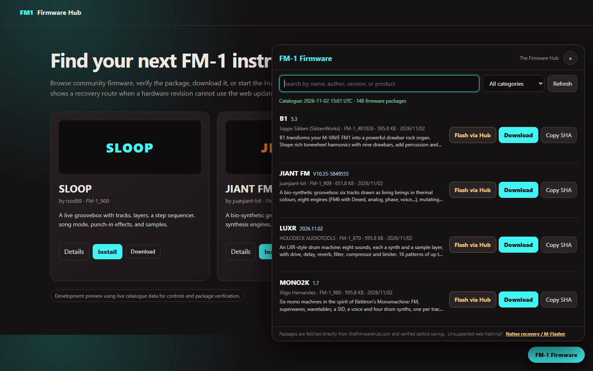
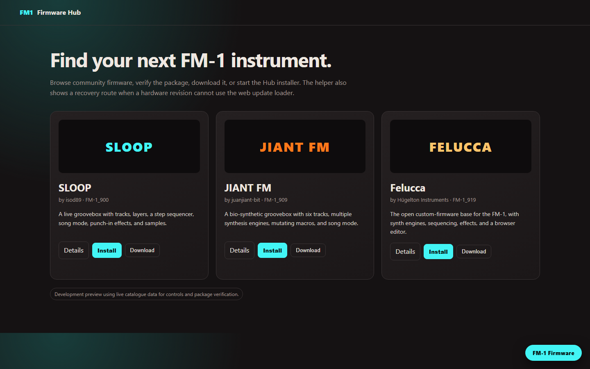

**English** | [简体中文](#chinese)

# FM-1 Firmware Downloader and Flash Helper

A Tampermonkey / Violentmonkey userscript for [The Firmware Hub](https://thefirmwarehub.com/). It adds firmware search, verified downloads, one-click Hub flashing, and a native recovery route for incompatible flash chips.

## Install

1. Install [Tampermonkey](https://www.tampermonkey.net/) or [Violentmonkey](https://violentmonkey.github.io/).
2. Open the **[userscript install link](https://raw.githubusercontent.com/1andesc/fm1-firmware-downloader/main/fm1-firmware-downloader.user.js)**.
3. Refresh The Firmware Hub.

## Features

- Reads the latest firmware catalogue on every visit.
- Adds search, category filters, and **Download** buttons to firmware cards.
- Verifies file size and SHA-256 before saving.
- **Flash via Hub** launches the Hub's native Web MIDI installer.
- Detects common web-flash failures and links to native recovery.

## Screenshots

## Recovery for web-flash failures

Some FM-1 units use an alternate flash chip, such as UC25HQ80 (`0xB36014`). Their firmware update loader may disconnect after a few write requests. This is not fixed by repeatedly pressing Install.

Use [M-Flasher](https://github.com/jvitkauskas/m-flasher/releases/latest) to access the chip's ROM download mode:

1. Download the release for your operating system and **extract the archive**.
2. Start M-Flasher and approve its administrator/elevation request.
3. Connect the FM-1 directly with a USB **data** cable. Close other MIDI applications.
4. With the FM-1 running, click **Download Mode**. If the firmware offers a recovery key combination, follow its documentation.
5. Wait until M-Flasher detects the unit, usually shown as `WL82 UBOOT1.00`, and reads the flash.
6. Click **Back up the whole flash** and keep the generated backup.
7. Click **Install firmware (.fwsc)**, select the downloaded package, and review the sectors M-Flasher will change.
8. When switching between different firmware families or data layouts, tick **Also erase settings and Bluetooth pairings**. Back up first: this clears the old settings but prevents stale presets or settings from being misread. Leave **Also put back the package's stock bootloader** unticked unless recovery specifically requires it.
9. Start the installation. Do not unplug the cable until every sector has been written and verified.
10. Click **Restart** or power-cycle the FM-1, then verify the firmware version in the device menu.
11. Restore the backup through M-Flasher if you need to return to the previous firmware.

Clearing settings does not fix a flash-ID incompatibility. If persistence still fails after a clean install, the firmware likely does not support the installed flash chip.

Official instructions: <https://github.com/jvitkauskas/m-flasher/blob/main/docs/usage.md>

> **Persistent-storage warning:** A firmware can boot successfully and still be incompatible with the installed flash chip. It may accept presets or projects but keep them only in RAM, so they disappear after power-off. Save a test preset, power-cycle the FM-1, and verify it is still present. Check the flash JEDEC ID if storage behaves unexpectedly.

The script verifies that a file matches the catalogue, not that the firmware is compatible with every hardware revision or flash chip.

MIT licensed. No firmware images are bundled.

---

[English](#english) | **简体中文**

# FM-1 固件下载与刷写助手

这是一个适用于 [The Firmware Hub](https://thefirmwarehub.com/) 的 Tampermonkey / Violentmonkey 用户脚本，提供固件搜索、校验下载、网页刷写和不兼容闪存芯片的底层恢复路径。

## 安装

1. 安装 [Tampermonkey](https://www.tampermonkey.net/) 或 [Violentmonkey](https://violentmonkey.github.io/)。
2. 打开 **[用户脚本安装链接](https://raw.githubusercontent.com/1andesc/fm1-firmware-downloader/main/fm1-firmware-downloader.user.js)**。
3. 刷新 The Firmware Hub。

## 功能

- 每次访问都读取最新固件目录。
- 增加搜索、分类筛选和卡片旁的 **Download** 按钮。
- 保存前校验文件大小和 SHA-256。
- **Flash via Hub** 调用网页自带的 Web MIDI 刷写流程。
- 检测常见失败，并提供底层恢复入口。

## 界面预览

## 网页刷写失败时

部分 FM-1 使用 UC25HQ80 等替代闪存芯片，例如 JEDEC ID `0xB36014`。更新加载器可能在少量写入请求后掉线，反复点击 Install 无法解决。

使用 [M-Flasher](https://github.com/jvitkauskas/m-flasher/releases/latest) 进入芯片底层下载模式：

1. 下载对应操作系统的版本，并**解压压缩包**。
2. 启动 M-Flasher，同意管理员权限请求。
3. 使用 USB **数据线**直接连接 FM-1，并关闭其他 MIDI 软件。
4. 如果 FM-1 正在运行，点击 **Download Mode**；若固件提供紧急组合键，按其说明进入。
5. 等待 M-Flasher 识别设备并读取闪存，通常会显示 `WL82 UBOOT1.00`。
6. 点击 **Back up the whole flash**，妥善保存完整备份。
7. 点击 **Install firmware (.fwsc)**，选择下载的固件，并检查将要改动的扇区。
8. 在不同固件家族或数据布局之间切换时，勾选 **Also erase settings and Bluetooth pairings**。必须先备份；这会清除旧设置，避免新固件误读遗留的预设或配置。除非恢复操作明确需要，否则不要勾选 **Also put back the package's stock bootloader**。
9. 开始写入；所有扇区完成并校验前不要拔线。
10. 点击 **Restart** 或重新开关 FM-1，在设备菜单确认固件版本。
11. 如需恢复旧固件，使用 M-Flasher 的备份恢复功能。

清除设置不能修复闪存 ID 不兼容。如果干净安装后仍然无法保存，固件很可能不支持当前闪存芯片。

M-Flasher 官方说明：<https://github.com/jvitkauskas/m-flasher/blob/main/docs/usage.md>

> **存储警告：** 固件能够刷入并正常启动，并不代表闪存芯片兼容。某些固件会接受预设或工程，但只在 RAM 中保存，关机后随即丢失。请保存一个测试预设，重启 FM-1 后确认它仍然存在；如果存储异常，应检查闪存 JEDEC ID。

脚本只能证明文件与网页目录一致，不能保证固件适配所有硬件版本或闪存芯片。

MIT 许可证。仓库不包含任何固件镜像。
